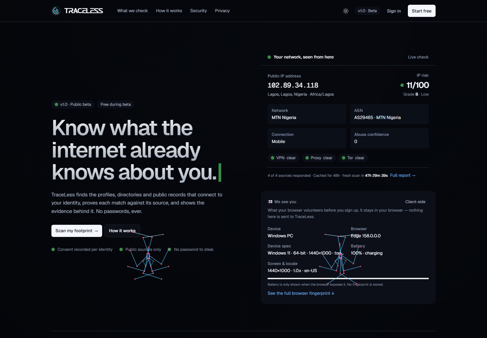
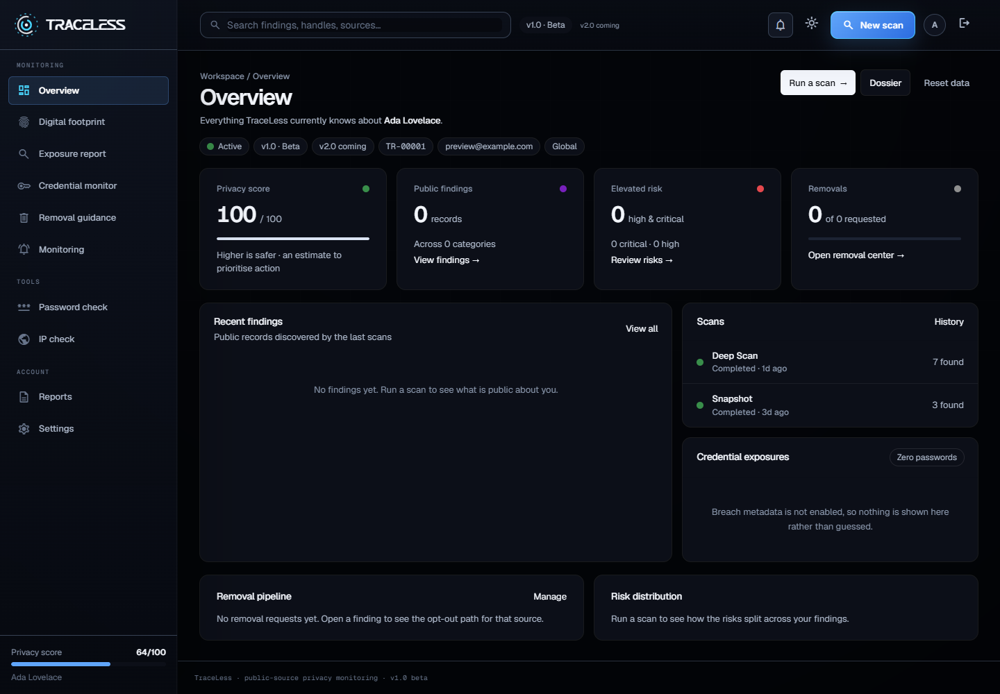

# TraceLess

Privacy-first digital footprint protection. TraceLess finds the personal
information that is **publicly** discoverable about you, tells you what it
means, gives you a removal path for each record, and watches for new or
reappearing exposure.

The product is passwordless and consent-gated: no account passwords exist, and
no scan runs without a recorded ownership attestation.

> **Status: v1.0 public beta — live at https://traceless.orrddy.store.**
> Free during the beta: snapshot scans, two-hour deep scans, monitoring and
> reports are open to every account. The app runs on Altare as one Docker
> container (nginx + PHP-FPM + scan/default queue workers + scheduler) with Neon
> Postgres, Resend mail, four-provider IP intelligence and a Vercel-style
> light/dark interface. Admin console covers users, scan forensics, sign-in
> locations, monitoring and account states. Billing arrives in v2.0.
> Current state and launch plan: [PROGRESS.md](PROGRESS.md).
> Source inventory and scan limits: [SCANNING.md](SCANNING.md).

---

## Screenshots

<p align="center">
  
</p>
<p align="center"><em>The landing page in dark mode — both live crawlers are on screen. Hover one to lure it, click to send it flying to a word.</em></p>

<p align="center">
  
</p>
<p align="center"><em>The signed-in user dashboard: privacy score, findings, scan history and the removals/credential state at a glance.</em></p>

## Where the project stands

| Area | State |
|---|---|
| First-visit intro film | **Working** — one-time, non-skippable landing intro (31s, H.264); completed state is stored only after `ended` and survives refresh |
| Guest quick scan | **Working** — 10 curated public-profile checks for one username, explicit ownership confirmation, 2 checks/IP/10 min, results transient and no account write |
| Passwordless authentication (email OTP) | **Working** — hashed single-use codes, expiry, lockout, resend cooldown, per-route throttles; sign-in IP/device history |
| Identity profile + recorded consent | **Working** — consent is re-validated before every queued scan |
| Snapshot scan | **Working** — up to 5 usernames against 23 curated WhatsMyName profile sites, evidence hash stored per finding |
| Deep scan | **Working** — up to 5 usernames × 732 account probes, 1 email × 220 services, 1 phone × 5 registration probes; backend budget 2h, worker timeout 7800s |
| Scan console | **Working** — instant page, photoreal NASA globe, server-timed 2h countdown that persists across devices/logout, results held until reveal |
| Findings, risk score, reports | **Working** — HTML dossier, 24h signed download URL, per-report token and Gate check |
| Removal tracking | **Working as guided tracking** — no automated removal engine yet |
| Continuous monitoring | **Working** — hourly dispatch, alerts, and admin pause/resume per identity |
| Credential / breach monitoring | **Not connected** — no breach provider configured; UI says so rather than implying a check |
| Admin console | **Working** — users, scan counts, sign-in IP/device history, monitoring, disabled/pending states, scan inspector, failed jobs, email log, activity log |
| Subscriptions and payments | **Not built** — free beta; billing is v2.0 |
| Uptime & CI | **Working** — GitHub Actions CI + external `/up` probe with Resend alert email |
| Interface refresh | **Working** — marketing site, app shell, dashboard, scan/IP/admin flows on the Vercel-style system; light/dark QA ongoing |

### Progress log

| Date | Change |
|---|---|
| 2026-11-14 | Audited the codebase, reconstructed the timeline, recorded outstanding work; tagged `baseline-2026-11-14` |
| 2026-11-15 | Production guard, reproducible test suite, honest verification screen, policy enforcement, retention + deletion hardening, live monitoring and alerts, brand identity |
| 2026-11-16 | Deep scans for usernames/emails/phones, self-service tools (password + IP check), data reset, notifications |
| 2026-11-18 | First production deploy (weeny.cloud), real-server deploy constraints fixed |
| 2026-11-19 | Administration panel: roles, users, activity log; operations surface: scan inspector, failed-job console, email delivery log, worker/scheduler heartbeats and `ops:alert` |
| 2026-11-23 | Migrated production to Altare (Docker image, custom domain, HTTPS), stopped the old weeny instance |
| 2026-11-23 | CI pipeline moved to the repo root and made green (tests + GHCR image builds) |
| 2026-11-23 | Vercel-style dashboard and app-wide light/dark brand; landing page rebuilt with product film, marquee, checks slider, rotating Nevera wordmark, typing headline and two word-eating crawlers |
| 2026-11-23 | IP intelligence engine: four providers, 48h cache, single-flight analysis, weighted risk score, public JSON endpoint, honest 503/422 states, enriched IP tool with cache countdown |
| 2026-11-23 | Free v1.0 beta gate (deep scans + monitoring for every account), deep-scan wall-clock budget, cache pruning, queued notifications and mail-failure recording |
| 2026-11-23 | Licensed third-party effects integrated (fluid water-ripple film background, two spider crawlers), a browser-exposed device check card, and the 48h IP-cache countdown |
| 2026-11-23 | Full “We see you” fingerprint panel (device-key + Web APIs) with honest Safari/iOS/Firefox gaps; image build fixed (docker vendor context + composer retries) |
| 2026-11-24 | Resend transport fixed (`RESEND_API_KEY` config name), branded scan-start and completion emails with Nevera wordmark; deep-scan-started email; uptime workflow; three.js Earth scan console with server-timed countdown; two-hour scan limits |
| 2026-11-25 | Random `TR-…` scan references; original monochrome dot-globe page loader on app/auth/marketing; photoreal NASA day/cloud/normal/specular globe, full-globe zoom; admin user intelligence (scan counts, sign-in IP/device history, monitoring pause/resume, disabled/pending verification); report download signature/host fix |
### Verified right now

- **235 PHP tests / 1,044 assertions** pass; Pint clean on 190 files.
- All **15 migrations** apply cleanly (including scan public references, IP cache, and login events).
- `https://traceless.orrddy.store` serves the app over HTTPS with valid certificates:
  `/up`, `/`, `/login` return 200; `/dashboard` redirects guests; admin pages are role-gated.
- The CI workflow on `main` runs the suite and publishes `ghcr.io/orrddy/traceless` on every push.
- The `Uptime` workflow probes `/up` every five minutes from GitHub and emails an alert on failure.
### Next up (before the 10 December beta)

1. **Deploy the latest image** (`fc5f282`) and verify the new login-history migration, report download and admin console in production.
2. **Pilot a real deep scan** — measure runtime, source failure rate and tune categories/timeouts; check the two-hour hold, emails and cross-device countdown.
3. **Resilience** — prove the uptime alert path, run a Neon restore drill and copy `/data` reports nightly.
4. **Legal + support** — business name, country, support address, subprocessor list on the privacy page.
5. **Security** — rotate the Resend key, Altare SFTP/API token and IP provider keys; decide public vs private repo.
6. **Launch surface** — beta waitlist, support inbox, announcement copy; freeze features 1 Dec; go/no-go 8 Dec; launch 10 Dec.
7. **v2.0 scope** — billing, team seats, image/face deep scans.

### Open decisions

- **Launch model** — confirmed: free public beta on 10 December, paid plans in v2.0.
- **Repo visibility** — currently public; decide whether to make it private before launch.
- **Monitoring plan gate** — free during beta via `TRACELESS_BETA=true`; v2.0 restores plan checks.
- **Second provider fallback for mail** — Resend primary; keep the DirectAdmin relay as a documented fallback.
## Repository layout

```
.
├── traceless-app/          Laravel 12 + Livewire 3 application
│   ├── app/                Livewire components, services, models, policies
│   ├── database/           migrations, seeders, factories
│   ├── resources/views/    Blade templates and the design system
│   ├── routes/             web, channels, console
│   └── tests/              PHPUnit feature and unit tests
├── python-services/        scanner worker and its tests (outside the web root)
│   ├── scanner/worker.py   verified public-source checks
│   └── tests/              unittest suite
├── docker/                 nginx, php-fpm and supervisor configuration
├── Dockerfile              multi-stage production image
└── docker-compose.yml      web, queue, scheduler and migrate services
```

## Requirements

- PHP **8.2+** with `pdo_pgsql` (or `pdo_sqlite` for local work)
- Composer
- Node.js **20+** and npm
- Python **3.11+** for live scans
- A queue worker and the scheduler — scans and retention do not run without them

## Local setup

```bash
cd traceless-app
composer install
cp .env.example .env
php artisan key:generate
php artisan migrate --seed
npm install
npm run build
```

Start the three processes the application needs:

```bash
php artisan serve
php artisan queue:work --queue=scans,default
php artisan schedule:work
```

Demo sign-in uses `test@example.com`. The six-digit code is sent by the mailer
configured in `.env` and is never rendered on screen.

## Testing

From `traceless-app/`:

```bash
php artisan test
```

From the repository root:

```bash
python -m unittest discover -s python-services/scanner/tests
```

`phpunit.xml` forces the `stderr` log channel, so the only write requirement is
a compiled-view directory. Where the tree is read-only, redirect it:

```bash
VIEW_COMPILED_PATH=/tmp/traceless-views php artisan test
```

## Demo mode vs live mode

| Mode | Behaviour |
|---|---|
| `TRACELESS_DEMO_MODE=true` (default) | Deterministic demo findings from a local catalogue. Every record is generated, not observed. |
| `TRACELESS_DEMO_MODE=false` | The Python worker issues real HTTP requests to 23 curated public sources and reports a finding only when that source's own existence rule matches. Blocked, timed-out or unmatched sources are recorded as `unknown`, never as findings. Every monitored username is checked, up to `TRACELESS_MAX_USERNAMES`. |

Snapshot scans send a **public username** to the worker. Deep scans additionally
send one monitored email and one phone number to the registration-probe engines;
every deep finding is labelled unverified because it proves an account exists,
not that data is exposed. Passwords, private content and subject-unsafe checks
never reach the worker. Credential checks are skipped until a breach provider is
configured.

## Configuration

Key variables, all documented in `.env.example`:

| Variable | Purpose |
|---|---|
| `TRACELESS_DEMO_MODE` | Switch between generated and verified findings |
| `TRACELESS_OTP_EXPIRY_MINUTES`, `TRACELESS_OTP_MAX_ATTEMPTS`, `TRACELESS_OTP_RESEND_COOLDOWN` | One-time-code policy |
| `TRACELESS_OTP_DEMO_DISPLAY` | Show email-change and account-deletion codes in Settings — **must be false outside local** |
| `TRACELESS_BREACH_PROVIDER` | Breach-metadata provider; empty disables the feature |
| `TRACELESS_PYTHON_BINARY`, `TRACELESS_SCANNER_SCRIPT`, `TRACELESS_PYTHON_TIMEOUT` | Worker invocation |
| `DB_URL`, `DB_LIBPQ_OPTIONS` | Neon/Postgres connection |
| `REDIS_URL`, `QUEUE_CONNECTION`, `SESSION_DRIVER` | Queue, cache and session backends |
| `MAIL_MAILER`, `RESEND_API_KEY`, `MAIL_FROM_ADDRESS` | Transactional email |

**Production safety guard.** The application refuses to boot when
`APP_ENV=production` and `APP_DEBUG`, `TRACELESS_DEMO_MODE` or
`TRACELESS_OTP_DEMO_DISPLAY` is still enabled. Start from
`.env.staging.example`, which sets all three correctly.

## Docker

```bash
cp .env.staging.example .env      # fill in real secrets
docker compose build
docker compose run --rm migrate
docker compose up -d web queue scheduler
```

The image runs PHP-FPM and nginx under supervisor and serves `/up` as its
health check. Compose mounts `../python-services` read-only for live scans, so
run it from a checkout that contains both directories.

## Security notes

- **No passwords are stored.** Authentication, email changes and account
  deletion all use short-lived email codes.
- **Consent is a gate.** A scan cannot be queued without a consent record for
  the identity.
- **Public data only.** No authentication bypass, no anti-bot evasion, no
  purchased breach dumps.
- **Ownership checks** scope identities, scans, findings, reports and removals
  to the signed-in user.
- **Reports** use signed URLs with a 24h lifetime plus an ownership policy and per-report token; every download is audited.
- **Sign-in history** stores IP, user agent and a conservative device label so owners can review account access; pending-verification accounts are blocked on the next request.
- **Secrets** live in `.env`, which is git-ignored; the repository contains only
  `.env.example` and `.env.staging.example`.

## Administration

The admin area lives at `/admin` and is only reachable by accounts whose
`users.role` is `admin` or `super_admin`.

| Page | Purpose |
| --- | --- |
| `/admin` | Operational counts, pending/disabled accounts, active monitoring, recent sign-ins, worker/scheduler heartbeats, queue and email health |
| `/admin/users` | Search/filter, scan totals, sign-in IP/device history, monitoring pause/resume, disable/enable, pending verification, role changes (super admin only) |
| `/admin/activity` | The audit log with search, action and date filters |
| `/admin/scans/{id}` | Per-scan forensics: every source outcome and block reason, findings, the failure message, retry and cancel |
| `/admin/failed-jobs` | Dead-letter console: exception excerpt, retry, delete, retry all |
| `/admin/email` | Delivery log for every outbound message, with transport errors |
| `/admin/sources` | Source verdict, unknown and blocked rates (7/30/90 days) |

Silent failures are covered twice over: the queue worker and scheduler write
heartbeats shown on the dashboard, and `ops:alert` (scheduled every ten minutes)
emails administrators when the worker goes quiet, failed jobs appear, or outgoing
mail starts failing.

**Provisioning is CLI-only** — there is no web route that can grant admin, so a
compromised client session cannot escalate:

```bash
php artisan admin:promote owner@example.com --role=super_admin   # or admin
php artisan admin:revoke owner@example.com                       # refuses to remove the last admin
```

Rules enforced in the component, not just the UI: nobody can suspend or demote
themselves, an `admin` cannot act on a `super_admin`, role changes require
`super_admin`, and suspended accounts lose all authenticated access (`active`
middleware). Two bypasses were closed during the security audit: Livewire actions
skip route middleware, so each mutating method re-checks the actor; and admin
components can be instantiated directly through `/livewire/update`, so each one
guards in `mount()` as well.

## Third-party attribution

Public-source discovery integrates [WhatsMyName](https://github.com/WebBreacher/WhatsMyName)
(CC BY-SA 4.0) and [user-scanner](https://github.com/kaifcodec/user-scanner)
(MIT). TraceLess does not guarantee removal from any third-party service, and
privacy scores are prioritisation aids, not assessments of fact.

## Licence

Proprietary. See the project owner before redistribution.
---

## Scan console & page loader

The scan progress screen renders a photoreal rotating globe with **Three.js** (MIT)
using NASA day, cloud, normal and ocean-specular maps (public domain). The camera is
framed so the full Earth stays visible; a faint scan band keeps the operation context.
The countdown uses absolute server timestamps (queue time + the two-hour deep-scan
window), so logout, another browser or a second phone shows the same remaining time.

Deep scans finish server-side when the crawl ends, but results stay hidden until the
window ends: the UI shows a calm high-traffic state and the completion email is queued
for the same reveal moment. Scans are referenced publicly by random `TR-XXXXXXXXXX`
ids; database ids stay internal.

The app, auth and marketing layouts share an original **monochrome dot-globe page
loader** with three 3D orbit rings and a white Nevera wordmark. It holds for a short
brand moment on first paint and does not replay between navigations; reduced-motion
and no-JS fallbacks are included. A custom `public/brand/page-loader.gif` (or
svg/webp/png) can override it.

## Uptime monitoring

`.github/workflows/uptime.yml` probes `https://traceless.orrddy.store/up` every five
minutes from GitHub's infrastructure and emails an alert through Resend when the status
is not 2xx/3xx. Add these repository secrets for alerts (Settings → Secrets and
variables → Actions):

- `RESEND_API_KEY` — same Resend key used by the app
- `ALERT_EMAIL` — where alerts should go (e.g. `orrddy@proton.me`)

Optional repository variable: `PROD_URL` (defaults to `https://traceless.orrddy.store`).
For SMS/phone escalation, point an UptimeRobot or Better Stack monitor at the same `/up`
endpoint and use the same alert address.

## Third-party effects (commercial licences)

Two interactive effects on the landing page are adapted from effect bundles whose
commercial-use licences were purchased from their authors' official distribution:

- **Water ripple distortion** — adapted from [Mouse Effects](https://github.com/cortiz2894/mouse-effects)
  by Christian Ortiz. The React Three Fiber implementation was ported to dependency-free
  WebGL2 (fluid ping-pong simulation, chromatic aberration, specular highlights) and now
  samples the product film as its texture. See `resources/js/vendor/water-ripple.js`.
- **Web Crawlers** — adapted from [Web Crawlers](https://github.com/cyohei9907/web-crawlers)
  by cyohei9907. The page-overlay spider (closed shadow root, no page mutation) was wrapped
  in a factory so the landing page runs two small crawlers. See
  `resources/js/vendor/web-crawler-spider.js`.

Credit is preserved in the source headers. The typewriter, device probe, film composition
and page layout are original TraceLess work.
## Browser fingerprint panel

The landing page's "👀 We see you" panel reads only what the browser itself exposes.
Device detection, OS, browser/engine/vendor, battery, network estimates and a canvas
fingerprint come from the MIT-licensed [`@marufme/device-key`](https://github.com/maruf-me/device-key)
package; GPU/renderer, storage quota, media capabilities and the local device id are
read directly from Web APIs. Nothing is transmitted or stored.

Safari/iOS and Firefox deliberately withhold parts of this surface. The panel prints
"Not exposed" with a browser-specific explanation instead of guessing:

- **iOS/iPadOS**: no battery API, no device memory, no network details, no user-agent
  client hints, and device model hidden. iPadOS is detected from the desktop-class
  Safari UA (`MacIntel` + touch) and labelled as iPadOS.
- **macOS Safari**: UA client hints, device memory and network information are hidden;
  WebGL vendor/renderer are masked. Hard-window model is not exposed.
- **Firefox**: UA client hints and device memory withheld; canvas/WebGL signatures can
  be randomised per session.